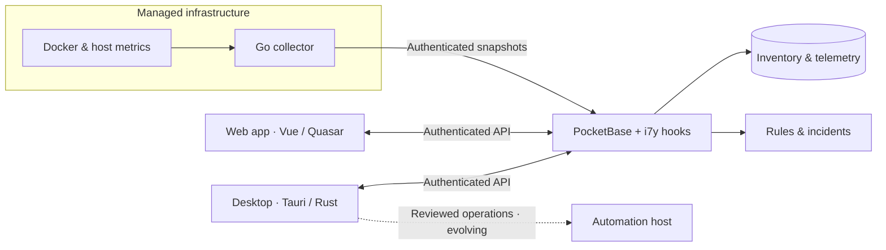

<div align="center">

# i7y

### Know your infrastructure. See what changes. Stay in control.

**Infrastructure inventory, real-time Docker awareness, telemetry, and incident management — in one workspace.**

[Website](https://i7y.devi.tools) · [Getting started](#-quick-start) · [Documentation](#-documentation) · [Report an issue](https://github.com/devitools/i7y/issues)


</div>

---

## What is i7y?

**i7y** brings scattered infrastructure information into one place. Keep track of servers, projects, containers, and the images they run; observe host and Docker telemetry; and act on incidents with context instead of jumping between terminals and dashboards.

Designed around a self-hosted backend, i7y combines a browser-based management interface, a lightweight Go collector, and a native desktop application. Its direction is simple: **from infrastructure visibility to carefully controlled operations.**

> **Project status:** i7y is under active development. Inventory, collection, alerting, and the core web/desktop experience are implemented in the repository. Remote desktop operations are being developed with explicit authorization and review gates; do not assume they are production-ready.

## ✨ Highlights

| | Capability | What it does |
| :-- | :-- | :-- |
| 🗂️ | **Infrastructure inventory** | Organize servers, projects, containers, Docker images, and repository metadata. |
| 📡 | **Automatic discovery** | Reconcile Docker container changes and discover project paths through the Go agent. |
| 📊 | **Host & container telemetry** | Collect resource metrics, Docker state, and historical observations. |
| 🚨 | **Alerts & incidents** | Define threshold rules, track incidents, acknowledge ownership, and review events. |
| 👥 | **Organizations & access** | Separate inventory contexts with organization membership and roles. |
| 🖥️ | **Web & desktop** | Use the Vue/Quasar interface in a browser or the Tauri desktop shell. |
| 🔐 | **Security-conscious design** | Scoped agent credentials, authenticated APIs, and reviewed desktop automation boundaries. |

### How it fits together



The collector observes and reports; **it does not deploy Compose files or modify application containers**. Remote operations follow a separate architecture and authorization process.

## 🚀 Quick start

### Prerequisites

- [Volta](https://volta.sh/) (the repository pins **Node 22.23.4** and **npm 10.9.9**)
- Docker with Docker Compose

### Run locally

```bash
git clone https://github.com/devitools/i7y.git
cd i7y
npm ci
docker compose up -d
npm run dev
```

Open **http://127.0.0.1:5177** to access the web app.

| Service | Local address | Notes |
| --- | --- | --- |
| Web app (Vite) | `http://127.0.0.1:5177` | Hot reload; proxies API requests to PocketBase. |
| PocketBase | `http://127.0.0.1:8097` | Local backend and trusted administrative setup. |

Docker Compose starts **only the backend**. The frontend runs locally through Vite. The first backend startup downloads and verifies the pinned PocketBase binary; subsequent runs reuse its cached copy.

A fresh installation contains no infrastructure inventory. For first-user setup, see [Authentication & API access](docs/api-auth.md).

### Useful commands

```bash
npm test                # Run repository tests
npm run typecheck       # Check web and desktop types
npm run build:web       # Build the web frontend
npm run backend:logs    # Follow PocketBase logs
npm run backend:down    # Stop the local backend
```

`npm start` and `npm stop` are shortcuts for backend startup and shutdown. `docker compose down` keeps the database volume; adding `--volumes` deletes persisted local data.

## 🧩 Components

| Location | Responsibility | Stack |
| --- | --- | --- |
| [`apps/web`](apps/web) | Management UI | Vue, Quasar, Vite, TypeScript |
| [`apps/backend`](apps/backend) | API, auth, rules, schema, migrations | PocketBase, JavaScript hooks |
| [`apps/agent`](apps/agent) | Host and Docker observation | Go |
| [`apps/desktop`](apps/desktop) | Native client and local controller integration | Tauri, Rust |
| [`apps/mobile`](apps/mobile) | Mobile client | See mobile documentation |
| [`apps/push-gateway`](apps/push-gateway) | Push-delivery infrastructure | See mobile API documentation |
| [`apps/automation`](apps/automation) | Reviewed remote operations architecture | Rust / controller |
| [`apps/site`](apps/site) | Product website | Website sources |
| [`packages/theme`](packages/theme) | Shared design assets | Shared package |

## 📡 Collect telemetry

The Go agent observes Linux hosts and Docker. It sends a complete snapshot on startup and every **five minutes**, and also follows Docker lifecycle and health events for faster reconciliation.

Build and test it:

```bash
cd apps/agent
go test -race ./...
./build.sh
```

The build generates Linux `amd64` and `arm64` binaries and checksums. Before deploying an agent, register the target server and create its scoped credential in **Telemetry**. Protect the agent's Docker socket access and its configuration file.

Read the step-by-step [agent installation guide](docs/install-agent.en.md) and [telemetry reference](docs/telemetry.md) before using it on a server.

## 🖥️ Native desktop

The Tauri desktop application shares the web UI while using a native Rust layer for supported operations. It connects to an existing i7y installation; **it does not start a backend**.

```bash
npm run desktop:dev
```

On first launch, enter your installation URL and sign in through the browser-based authentication flow. Remote production instances require HTTPS with a trusted certificate.

For platform prerequisites and build instructions, see [Desktop setup](apps/desktop/README.md). SSH diagnostics and the controller architecture are described in [Desktop operations](docs/desktop-operations.md) and [Desktop MCP](docs/desktop-mcp.md). **Remote server mutations are subject to additional security and pilot requirements.**

## 📦 Production deployment

Build the container image:

```bash
docker build -t i7y:VERSION .
```

The production image packages the built frontend with the PocketBase runtime and backend hooks. The deployment template is at [`deploy/compose.production.yaml`](deploy/compose.production.yaml) and expects `I7Y_DOMAIN`, `I7Y_VERSION`, and an external reverse proxy.

**Back up and preserve your deployment's persistent data mount when upgrading.** Building an image does not deploy it.

## 📚 Documentation

| Topic | Guide |
| --- | --- |
| Authentication and scoped access | [API authentication](docs/api-auth.md) |
| Organizations and roles | [Organizations](docs/organizations.md) |
| Telemetry protocol and behavior | [Telemetry](docs/telemetry.md) |
| Installing collectors | [Agent installation](docs/install-agent.en.md) |
| Alerts, rules, and incidents | [Alerts & incidents](docs/alerts.md) |
| Containers API | [Containers API](docs/containers-api.md) |
| Repository metadata | [Project repositories](docs/project-repositories.md) |
| Desktop configuration | [Desktop setup](apps/desktop/README.md) |
| Desktop operation boundaries | [Desktop operations](docs/desktop-operations.md) |
| Mobile architecture | [Mobile API](docs/mobile-api.md) |
| Third-party notices | [Third-party notices](THIRD_PARTY.md) |

## 🤝 Contributing

Issues and focused pull requests are welcome. Before proposing changes, run the available checks and follow the repository conventions:

```bash
npm test
npm run typecheck
npm run build:web
```

Keep source code, identifiers, errors, test descriptions, and canonical documentation **in English**. Interface translations belong in `apps/web/src/locales/<locale>/`. Never commit credentials, real inventories, backups, or installation-specific data; keep these in the Git-ignored `.local/` directory.

For defects and proposals, [open an issue](https://github.com/devitools/i7y/issues).

---

<div align="center">

**Visibility first. Controlled operations next.**

Made by [DeviTools](https://github.com/devitools) · [i7y website](https://i7y.devi.tools)

</div>
